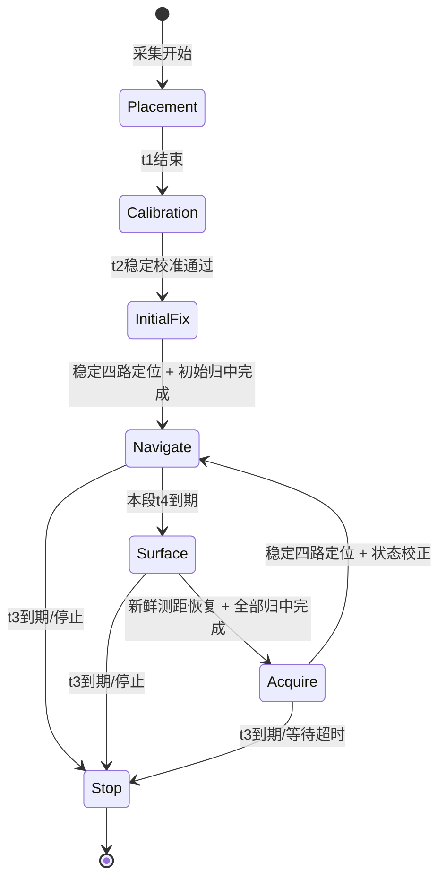

# 水下定点导航设计（已确认实施）

日期：2026-10-26。状态：用户修改后已确认执行，代码及验证记录见对应实施计划和 README_UNDERWATER_NAVIGATION_20261026.md。

目标：给定水深和一个水平目标点，在水面完成放置、标定与初始定位后，同时控制胸鳍定深、尾鳍导航；水下以 IMU 粗略推算水平位置、压力提供深度；定时停止导航并上浮，测距恢复后全部舵机归中，取得稳定四路 UWB 定位后校正状态，再下潜导航。

文中的参数是待确认的实现初值，不是已通过实机验证的精度保证。人工下沉日志用于确定数据处理方向，不作为自主下潜成功或水平定位精度的证据。

## 1. 现有程序已经如何工作

本设计检查的是当前工作区源码，包含用户尚未提交的水面导航修改。后续实现保留这些修改，不回退到旧版本。

| 环节 | 固定深度程序 | 水面导航程序 | 新程序的处理 |
|---|---|---|---|
| 入口 | `scripts/run_fixed_dive_20260920_100122.py` | `scripts/run_surface_navigation_20261010.py` | 新建独立入口，不同时运行两个旧进程 |
| 参数 | robot.yaml＋RL 配置中的采集、标定、运行项；不加载网络 | robot.yaml 的 `surface_navigation_20261010` | 同一 robot.yaml 新增独立水下段；复用已有几何与尾鳍参数 |
| 采集 | `SensorManager`；IMU/UWB UART、深度/电源 I²C、独立缓冲 | 同一管理器，但仅启用 IMU/UWB | 一套管理器启用 IMU/UWB/深度/电源，关闭相机 |
| 压力 | 强制 10 Hz；`PressureDrift` 查表；`FixedDepthCalibration` | 不使用深度 | 沿用查表、P0 和深度计算，首样本计时不重置 |
| 校准 | `RLSensorCalibration` 检查姿态稳定、四元数/欧拉一致、重力残差、角速度、压力稳定 | `CalibratedIMU` 校准欧拉零点并低通；要求标定窗口覆盖 | 同一 t2 窗口做完整 IMU＋压力标定，再估计加速度残差均值 |
| 尾鳍 | 不控制 | `NavigationPolicy`＋`NavigationTailAction`：三个尾鳍相同中位偏移 | 原样复用当前 PI 和大角差转向规则 |
| 胸鳍 | `FixedDivePolicy`＋`ContinuousFinAction`：每组两个 action2，完成回执后推进 | 不控制 | 沿用 PI、两动作组合、b2 交替和镜像轨迹 |
| PWM | `RLServoExecutor` 单线程写入 4–7 | 同一执行器，仅写入 1–3 | 一个执行器写入 1–7，允许一个尾鳍动作与一个胸鳍动作同时运行 |
| 暂停 | 达到目标时保持最后端点；并非自动归中 | `request_hold()` 可直接归中尾鳍 | 正常定深沿用端点保持；上浮取数明确全归中；到达水平目标只归中尾鳍 |
| 时间结束 | 等本组完成后退出；故障可立即中断 | 总时限定时器立即请求停止 | t3 到期立即停止推进，正常路径归中后关闭 PWM；故障沿用紧急关闭 |

关键源码约束：

- `FixedDivePolicy.set_target(0, error_scale_m=正数)` 已支持零米目标；必须在组边界调用，不能用零作为归一化分母。
- `FixedFinSequence` 要求 b1=0、1 顺序，完成的 b1=1 的 b2 正负交替；普通暂停不能破坏这个状态。
- `RLActionScheduler.hold()` 中断胸鳍后设置 `_fin_sequence_interrupted`，默认拒绝恢复；新调度器必须只在确认完整胸鳍归中后重建序列，不能简单清标记后续发旧动作。
- `NavigationScheduler` 当前只接受尾鳍，不能直接作为七舵机调度器。新建组合调度器复用其尾鳍轨迹，并复用固定深度调度规则。
- 当前 `NavigationPolicy`：距离到点优先暂停；航向误差 ≥45° 用同侧 +30°/+20°，≤−45° 用 −30°/−20°；其他情况 PI。强转向每个动作结束后用最新航向判断是否切回 PI，新程序保留。
- 当前水面 `position_from_ranges` 不执行残差和越界拒绝；会话对缺基站帧复用旧完整定位，并刷新另一个新鲜度时间。新程序不沿用这两个判断。

## 2. 方案选择

| 方案 | 优点 | 代价 | 本设计选择 |
|---|---|---|---|
| 同时启动两个原脚本 | 看似改动少 | 重复打开串口、I²C/PWM；时间和暂停无法统一 | 排除 |
| 一个会话，复用动作和采集，加入简单惯性估计及水面校正 | 逻辑直接、依赖少、易于回放和调参 | 惯性误差不能给出严格协方差界限 | 推荐，待确认 |
| 完整姿态误差状态 EKF＋UWB 原始测距融合 | 可系统估计部分误差和不确定性 | 需要更多模型、噪声参数和可观测性验证 | 留作后续，不作为首版要求 |

首版以“可解释的粗导航”实现，不将滤波后的结果称为高精度定位。

## 3. 时间定义

所有时限使用单调时钟，原始样本使用采集时间，禁止用日志写入时间积分。

| 参数 | 定义 | 建议初值 |
|---|---|---:|
| t1 | 开始采集后的人工放置/预热时间；鱼头朝水池 +X，不初始化或运动舵机 | 5 s |
| t2 | t1 之后固定长度的静止标定窗口；不叠加旧程序的额外预热等待 | 5 s |
| t3 | 首次进入导航后的总任务时间，包含到点暂停、上浮、归中、等待 UWB；重定位不重置 | 120 s |
| t4 | 每次进入/恢复导航后的最长导航段时间，含下潜和到点保持；到期触发上浮 | 5 s |

t4 从导航恢复开始计时，不从完全失去 UWB 时开始，也不从达到目标深度才开始。这样不需要以有误差的深度阈值判断“已下潜”。5 秒是可调的短段验证起点，不是已证明可以达到某一精度的时长。

t1、t2、初始稳定 UWB 获取及初始舵机归中不计入 t3。初始定位最多等待 30 秒；不会因 t3 尚未开始而无限等待。t3 是动作任务截止时间，归中/释放 PWM 有独立的有界清理时间。t3 到期优先级高于 t4 和所有阶段等待，不再执行“最后一次上浮”。

## 4. 任务阶段

### Placement / Calibration / InitialFix

采集和原始日志始终运行；不创建真实舵机控制器。t2 只使用窗口内有效样本，检查样本数、时间覆盖、间隔和最新样本年龄。失败就结束并报告原因，不用动作中的数据补成“静止标定”。

初始位置必须来自 t2 结束后的新完整 UWB 帧，旧缓存和旧半帧不参与。取得初始稳定位置后启动唯一 PWM 执行器并确认全归中，重新等待归中之后的新稳定窗口，避免初始化动作改变姿态却仍使用动作前位置。初始获取总体也受 30 秒等待预算限制。随后设置初始位置/速度，进入 Navigate 并启动 t3、t4。

### Navigate：胸鳍定深与尾鳍导航同时执行

- 胸鳍目标 `h0>0`，用压力深度调用原固定深度 PI；新深度样本持续更新积分，但一个已开始的两动作组合保持其冻结角度。
- 尾鳍用当前估计 `(x,y)` 和低通航向运行原导航规则，不等待 UWB 才作决策。按当前动作完成回执推进，避免为每个 200 Hz 样本提交新动作。
- 到达水平容差时，尾鳍停止新摆动并在下一 PWM 周期归中，胸鳍继续定深。漂出容差恢复尾鳍，t3、t4 均不中断。该“到达”仅依据估计位置，不视为外部真值验证。
- 这一阶段 UWB 继续记录，但不使用临近入水的零散帧自动覆盖位置；校正统一发生在归中后的稳定取数阶段。

### Surface：停止导航，只用胸鳍上浮

1. t4 到期立即停止尾鳍调度，在 PWM 线程取消当前尾鳍动作、归中 1–3。定深组合若未完成，允许剩余半程结束，最多延迟一组剩余时长；期间不启动下一组下潜动作。
2. 在组边界将目标改为 0，误差归一化尺度仍用本次 `h0`，清除深度 PI 积分；只执行胸鳍。尾鳍持续保持中位。
3. 从进入 Surface 的时间边界起，只检查新的正确标签 mc 帧。默认连续两个不同身份的 mc 帧，各至少有一路有效距离，间隔 ≤0.3 秒，最新帧年龄 ≤0.3 秒，就认为“已可收取 UWB”。`ok=true`、KT 显示行、RANGE_ERROR、旧帧和无有效距离的 mc 都不能触发。
4. 立即请求全部归中：可以取消未完成胸鳍半程，不等待下一组。只有 PWM 归中回执成功，才进入 Acquire。

“连续两帧、至少一路”是对用户“能获取 UWB 就停止胸鳍”的具体化，目的只是抑制单个偶发帧；不代表已经获得可信定位。若 t4 触发时鱼仍在水面，新帧也可满足该条件，无须强求先丢锁后恢复。

上浮期间压力读数可能略小于零，新程序用于上浮控制的深度取 `max(depth,0)`，避免负误差命令向下拍动。若读数非正且 UWB 仍不可用，则在当前胸鳍组完成后归中，仍处于 Surface 的“压力零点暂停”，不进入 Acquire，也不锁定为上浮成功。随后若连续 3 条新的有效压力样本均显示深度 >0.02 m，重新建立胸鳍序列、清 PI 积分，继续以目标 0 上浮；b2 按最后确认完成的动作接续。0.02 m 是可配置的恢复回差，避免围绕零点反复启动。收到满足条件的新 UWB 时优先按正常路径全归中并进入 Acquire。压力暂停/恢复不重置本次 30 秒上浮预算，超过预算则结束任务。

### Acquire：胸鳍与尾鳍都归中，获取稳定位置

归中确认后清空本阶段 UWB 稳定窗口并重置流解码的半帧；仅纳入归中确认时间之后的数据。先等待 1 秒机械/水面扰动消退，再开始新的稳定窗口。传感器、压力和惯性状态继续更新。

取得第 7 节定义的稳定定位和速度估计后，按第 6 节校正状态，重新建立导航 PI、胸鳍动作序列并恢复 h0，再次进入 Navigate。此时 t4 重新计时，t3 继续原计时。

如果测距随后又丢失，保持所有舵机中位，不自动恢复拍鳍；等待不超过 30 秒或 t3 剩余时间。超过后结束任务。这符合“收得到 UWB 后停止胸鳍，再等待四路”的顺序，避免反复拍鳍扰动水面。

### 特别注意第一次不需要经历t4阶段，传感器数据校正完就立马执行，后面的上浮需要经历t4阶段

## 5. 采集、坐标和启动标定

### 采集与时间处理

- IMU 保持 200 Hz，压力固定 10 Hz，UWB 复用原 UART worker 的 CRLF 原始字节流，电源沿用 robot.yaml。
- 控制循环约每 5–10 ms 执行一次，将新增传感器样本按采集时间处理；原始和估计日志分别保存。
- UWB 失联是正常水下状态，不触发任务级故障；IMU/压力/电源使用新任务自己的新鲜度检查，不继承 RL 配置里的 `enforce_data_freshness: false`。
- 记录 IMU TID、缓冲序号间断；重复/乱序帧不积分。相邻 IMU 有效时间差 >0.05 秒时不跨间隔强行积分，退出运动并报告缺口；最新 IMU 年龄 >0.1 秒、压力 >0.3 秒、电源 >2 秒按既有故障停车方式处理。
- 当前 IMU 时间由 TID 和配置周期重建。代码保留时间来源，不宣称已验证硬件级同步；长期时间漂移和固定延迟仍需实测。

### 压力

沿用 `P_corrected = P_raw − f(elapsed)`，`depth = (P_corrected − P0)/(rho*g)`。P0 取 t2 窗口修正压力均值，漂移模型的起点取整次采集首条有效压力。

在传感器启动前接入已有 `ObservedPressureBuffer`，锁定首条样本并使连续压力读取失败可追踪；不等 t1 结束后才从有限缓存中找起点。归中、每次上浮均不重置漂移时间或 P0。收到 UWB 不代表压力传感器恰为零深度，禁止因此自动修改 P0。

### 坐标

- 用户接口 `(x,y,z)`：X 沿 A0→A1，Y 沿 A0→A3，**z 为压力深度、向下为正**，单位米。
- 惯性计算暂用世界 Z 向上，输出时 `z=-p_world_z`，避免把原四元数的世界轴直接改符号后混用。
- t1 要求鱼头朝水池 +X。默认沿用当前 `yaw_sign=+1`、IMU X 与鱼头前向一致的安装约定；世界水平加速度按启动 yaw 零点旋转到水池 XY，航向使用同一参考。
- 首版对 `yaw_sign=-1` 明确拒绝并提示先验证完整坐标映射；不能只反转航向而不反转对应加速度坐标。若当前硬件安装不满足默认前向约定，必须先给出安装变换，再调整设计，不能靠测试调 PI 掩盖。
- 第一版将标签、IMU、压力参考点的相对位移视为可忽略，用深度位移修正标签高度；小型鱼在倾斜时的天线杆臂误差会进入定位残差，尚不实现完整刚体杆臂补偿。H 必须采用“基站到初始水面标签天线”的高度差。

### t2 校准内容

1. 复用 `RLSensorCalibration` 的四元数/欧拉、重力、角速度、压力稳定性检查；默认原有 1° 角度标准差限制及 100 Pa 压力标准差限制。
2. 最少样本数根据 t2 和配置采样率计算，要求至少 80% 时间覆盖、90% 预期样本数量，不能用增大 t2 后截断为最后 1000 帧的 IMU 缓冲冒充完整窗口；在 t2 期间逐批积累窗口数据。
3. 候选加速度机体系零偏：`b_body = mean(a_body − R(q)^T·[0,0,g])`。只在全套稳定性检查通过后发布校准结果。
4. 航向零点/低通沿用 `CalibratedIMU` 的圆周处理；重力去除始终使用原始完整四元数，不使用归零后的欧拉角。

## 6. IMU 滤波、积分与水面校正

采用简单的状态对象维护 `p、v、b_body、滤波器状态、最后时间戳`，不引入完整 EKF，也不额外依赖 SciPy。

### 在线传播

1. 每条有效 IMU 样本归一化四元数，检查有限数、范数与协议约定。
2. 计算 `a_world = R(q)·(a_body−b_body)−[0,0,g]`，再旋转到与航向相同的水池参考。
3. 对去重力后的每轴加速度串联两个一阶因果低通：每级 `alpha = 1−exp(−dt/tau)`，`tau=0.20 s`。姿态航向控制低通保持 `tau_yaw=0.15 s`。不使用依赖未来样本的居中平均或 filtfilt，要求低通滤波器的参数在robot.yaml里可调。
4. 用滤波加速度和真实 dt 作速度、位置的梯形积分。不中途硬清水平速度，不通过速度裁剪来伪造稳定位置，也不把全段均值强制减成零。
5. 压力每到一条新样本，先用 `tau_depth=0.15 s` 因果低通，再直接约束输出 z 和内部垂向位置；垂向速度从连续滤波深度差分后低通，避免无约束双积分。控制胸鳍沿用原策略所需的修正压力深度，不因导航显示滤波改掉原 PI 行为。

滤波依据：10 月 19 日动作组约 0.68 s，去重力 X/Z 主峰约 1.47 Hz。上述两级低通在 1.47 Hz 的连续时间近似幅值约为原来的 0.23，低频延迟约 0.4 s；它是抑制摆鳍周期的可配置折中，不能消除零偏。实施时须用原始日志确认频谱衰减及位移变化，不以曲线更平滑判定精度提高。

### UWB 恢复时的状态更新

- 稳定 UWB 窗口的 `t_fix` 明确定义为最后一个保留完整帧的采样时间；线性拟合在此时刻求出 `(x,y,vx,vy)`。压力提供处理到该时刻的滤波深度；用窗口中的实际样本时刻拟合速度，禁止将相邻两帧的抖动直接差分成速度；去掉异常值。
- 在 t_fix 校正位置和水平速度，然后重放 t_fix 之后已缓存的 IMU/压力样本到当前时刻（保留最近 5 秒的有界历史），不能把 2 秒窗口中心的位置直接贴到“现在”。历史检查点包含加速度/压力低通状态，回放先恢复检查点，不能在当前滤波器上重复处理旧数据。校正不重置 t3，也不重新标定 yaw 零点。初始启动时历史状态尚不齐全，则在当前已接受定位时刻初始化并从该时刻之后传播；运行中的历史缺失则拒绝该次校正并等待新稳定窗口。
- 每次校正记录位置创新、速度创新、窗口离散度及数据年龄。初始速度采用稳定窗口拟合值，不因为“归中”就设为零。
- 默认开启位置/速度校正；**默认不开启自动重新学习加速度零偏**。这是首版为保持可解释性作的选择：浮在水面并不等于静止，仅一个恢复位置无法区分初速误差和加速度偏差。
- 保留可配置的静止窗口零偏更新开关：全归中、稳定四路定位速度模长 <0.03 m/s、陀螺模长 <0.05 rad/s、去重力加速度各轴标准差 <0.05 m/s²、压力深度标准差 <0.005 m，以上连续满足 2 秒，才允许以增益 0.1 更新机体系残差均值；单次每轴变化限幅 0.005 m/s²。条件不满足就跳过，不延长本次定位等待。它仍是静止假设下的辅助校准，需后续验证后启用。

## 7. UWB 的稳定定位规则

### 基站来源和几何

第一版直接复用 robot.yaml 中已有的 `surface_navigation_20261010.L/W/H`：A0=(0,0,−H)，A1=(L,0,−H)，A2=(L,W,−H)，A3=(0,W,−H)，这里 z 向下为正。新水下配置段不再复制一份不同的 L/W/H；H 必须填写，不能用未知高度通过残差检查。

50×26.5 米表示此处配置的矩形边长，前提是基站实际按该矩形布置。首版只支持现有同高矩形约定；任意四点、不同高度需另行扩展，不能把池体尺寸误当实际基站坐标。

### 分别处理“收到信号”与“可以定位”

Surface 使用第 4 节的“连续两个新 mc、每帧至少一路有效”条件停止胸鳍；InitialFix/Acquire 必须四路来自**同一完整帧**，不拼接不同时间的基站值。

使用 `UWBStreamDecoder.feed(raw_bytes, include_incomplete=True)`，对完整、部分帧都额外按帧身份做有界去重；序号间断时清半帧。显示行、失败报文、重复帧不增加窗口样本数量、不刷新最后完整测量时间。部分帧不能参与位置求解。

### 归中后的稳定窗口（初值，可配置）

1. 归中后静置 1 秒；随后维护最近 2 秒完整帧窗口。至少 12 帧、覆盖 ≥1.5 秒，最新完整帧年龄 ≤0.3 秒，相邻有效完整帧间隔不能超过 0.3 秒。
2. 对每路距离做窗口中位数/MAD 诊断。超出 `max(0.15 m, 3×1.4826×MAD)` 的帧作为候选离群帧剔除；仍须保留 ≥80% 帧和至少 12 帧，且保留帧的时间覆盖仍满足上项。每路 MAD ≤0.08 m。
3. 用保留帧的四距离平方差求每帧 XY，保留未裁剪坐标；再用该帧可用压力深度和 L/W/H 反算四路斜距。每帧测距残差 RMS ≤0.5 m，窗口中位距离求出的参考解也须通过残差检查；任何后续筛除都要重新检查保留比例、样本数量和覆盖。
4. 对保留 XY 拟合线性位置随时间变化，剔除明显异常点后检查：相对拟合轨迹的二维偏差 P90 ≤0.25 m，前后半窗拟合速度差模长 ≤0.10 m/s，总拟合速度模长 ≤0.5 m/s。允许低速平移，不把缓慢漂流强行当作零速度。不能把位置稳定直接等同于绝对准确。
5. 连续 0.5 秒的检查都通过，且期间至少出现 3 个新的完整帧身份，才发布一次重定位结果。所有失败原因记入日志，不能循环对同一缓存窗口“连过三次”视为新证据。

上述规则将原始测距异常、窗口稳定性和几何一致性分开。每次重定位仅发布一次任务状态校正；滤波器不能拿相同帧重复累积置信度。获取阶段发现一帧异常可以剔除并等待窗口重新满足条件，但不能沿用先前“已稳定”的标志。

不做坐标强制裁剪。池外解先保留为诊断；超出矩形及 0.25 m 容差则拒绝用于恢复导航。这是新任务自己的质量检查，不修改旧水面脚本的池外坐标行为。

## 8. 舵机并行、取消与重新启动

坚持一个 PCA9685 控制器、一个 `RLServoExecutor` PWM 线程。主线程只提交动作或归中请求，不直接写舵机；每种动作最多一个在途请求，不堆积整串动作。

新 `UnderwaterScheduler` 使用原轨迹计算及实际中位/限位：

- 尾鳍 1–3：相同相对角，原五次插值，原 `t_0` 定义（包括 t_0=0 直接写端点）。
- 左胸鳍 4/5：根部相对角与鳍尖耦合；右胸鳍 6/7 按原中位镜像，使用 robot.yaml 的实际中位和行程，不假设 90°。
- 进入 Surface 时只取消/归中尾鳍，胸鳍组保持完成规则；Acquire 时允许取消并归中全部。
- 全归中成功后才重建胸鳍序列，从 b1=0 开始，首个 b1=1 使用上次**确认完成**的 b2 的相反值（从未完成则用 initial_b2）。被取消半程不算完成，也不能推进 b2。
- Surface 内因压力非正暂停、随后深度回到恢复回差以上时，也必须遵守已归中确认和序列重建规则；不能把这种临时暂停误认为 Acquire，或直接续发归中前第二半程。
- 已取消请求的迟到完成回执按阶段代号丢弃并记录，不进入新阶段的 `acknowledge()`。
- 为支持“只归中尾鳍”，给现有执行器增加可选的通道组归中请求，默认不传参数时行为保持不变；归中写入、取消对应活动/待执行动作、回执均在 PWM 线程。兄弟组的动作与队列不得被清除。新调度器负责已归中组的序列重建；现有调度器默认中断保护仍保留。

这是预计唯一需要扩展共享执行基础设施的地方，必须测试旧固定深度、水面导航和 PPO 原有暂停语义不变。

## 9. 结束和故障

- t3 到期：独立任务定时器只向 PWM 线程发出全归中停止请求，不依赖下一条 UWB/IMU或控制台打印返回；禁止再提交动作。确认回中后关闭 PWM，结果为 `time_limit`。
- 截止请求必须在执行器请求锁内原子地封闭新动作入口，并撤销旧动作队列；不能只在主线程先检查一次截止时间，再允许一个与定时线程竞争的动作排到归中请求之后。尾鳍单组归中也必须先关闭该阶段对应动作的提交，再取消该组旧请求。
- Ctrl+C/外部停止、传感器关键数据失效、过流/低压/超深、PWM 写入失败：沿用现有故障处理，停止动作并尽力关闭全部活动通道，不在故障下继续强行运动回中。
- 非硬件故障的定位等待/上浮超时：全归中并结束，不带着失去定位的状态重新下潜。
- 回中确认、线程退出和日志关闭均有上限；报告部分失败，不把“已提交请求”等同于“硬件已完成”。
- 关键传感器或日志故障不被 UWB 正常失联逻辑吞掉。停止期间继续排空原始日志，保存最后状态和退出原因。

## 10. 文件与参数组织

预计新增：

| 文件 | 职责 |
|---|---|
| `scripts/run_underwater_navigation_20261026.py` | 参数、MOVE 确认、信号处理、创建会话目录 |
| `control/runtime/underwater_navigation_20261026.py` | 配置、惯性估计、稳定 UWB 判断、组合调度器等纯计算 |
| `control/runtime/underwater_navigation_session_20261026.py` | 采集、校准、阶段转换、并行控制、日志、清理 |
| `tests/test_underwater_navigation_20261026.py` | 计算和阶段边界测试 |
| `tests/test_underwater_navigation_session_20261026.py` | 模拟完整任务与故障测试 |
| `README_UNDERWATER_NAVIGATION_20261026.md` | 中文使用说明、坐标与参数、日志解释 |

修改：robot.yaml 新增 `underwater_navigation_20261026`；执行器/调度器仅增加通道组归中所需的兼容接口及测试。其他旧算法与入口保持原行为。

入口提供 `--h0 --x-d --y-d --t1 --t2 --t3 --t4`，胸鳍和尾鳍的舵机控制参数，其余滤波/定位质量参数放在 YAML，避免过长命令。实机沿用 `--confirm MOVE`；提供 `--dry-run`（全模拟）及 `--no-servo`（真实采集与估计、绝不创建 PWM 后端）。单目标点先完成，不扩展顺序多目标。

新段建议主要默认值：h0=0.3 m、depth_kp=1、depth_ki=0、fin_duration_s=0.3；尾鳍幅值/PI 沿用当前水面配置，水平到点容差暂沿用 `delta_s` 并在说明中强调它不是定位精度。t1=5、t2=5、t3=120、t4=5；滤波和 UWB 初值按第 6、7 节。h0 必须低于安全深度，t3/t4 有限且为正。

`--no-servo` 不运行“主动下潜/上浮”状态转换；正常完成 t1/t2 后立即开始 t3 诊断计时，无须等待初始 UWB，持续记录 IMU、压力和可获得的 UWB 稳定解。t4 不触发运动，不能把人工运动记录当作自主导航完成。

## 11. 日志和可验证结果

继续保存 raw_imu/raw_uwb/raw_depth/raw_power、metadata、calibration、pressure_drift 快照、events、commands。打开摄像头图像保存。新增一份 navigation 日志记录阶段、目标、估计 XYZ/速度、原始及滤波加速度、有效定位时间、压力时间、UWB 窗口质量、位置/速度校正创新、b_body。200 Hz 估计日志与低频控制决策字段可分文件避免无用重复。

实时状态约 1 Hz：阶段、XYZ、距目标、深度目标、下一次上浮剩余秒数、t3 剩余秒数、四路有效数与稳定性拒绝原因。日志中的“到点”“上浮完成”“定位恢复”使用不同事件名。

验收至少覆盖：

1. t1/t2 不构造 PWM；活动标定失败不启动运动；P0 与漂移起点跨周期不重置。
2. 尾鳍和胸鳍同时运行，原镜像/耦合/限位不变，传感器采集不中断。
3. t4 在尾鳍动作中间、胸鳍第一/第二半程到期；尾鳍及时归中，胸鳍正常组边界改目标；新 UWB 提前触发归中时不漏取消队列；Surface 压力短暂非正后再超过 0.02 m，按三条新样本确认恢复，不能永久停住或高频切换。
4. 部分 mc 可触发停止上浮但不能定位；KT、错误、重复、陈旧帧不能触发；归中前的数据不能填充归中后窗口。
5. 模拟初次恢复偏大、A2 跳点、四路不一致、持续运动及间歇失锁，不因同一窗口重复检查而误判稳定。
6. 静止 IMU 不漂移，已知加速度/转动方向下坐标和积分符号正确；不跨数据缺口积分；压力约束和 UWB 延迟校正使用正确时间。
7. 单独尾鳍暂停不影响胸鳍；全部归中后可以执行下一轮胸鳍序列；迟到回执不能污染新阶段。
8. 多次 Navigate→Surface→Acquire→Navigate；t3 在每个阶段都能结束，所有线程和 PWM 完成关闭；旧相关测试回归通过。
9. 用 20261019 日志回放验证解码、失锁/恢复过渡、滤波响应。因基站位置遗失，不用该日志宣称几何定位误差改善。

## 12. 本次确认范围

请确认是否按本设计进入实现，重点是以下方案选择：

- t3 包含上浮/等待，t4 从每次导航恢复计时；到点保持仍定时上浮。
- 新鲜部分测距连续两帧即可停止胸鳍，但只有归中后的稳定四路窗口才能恢复导航。
- 初版使用 IMU 两级因果低通＋积分、压力约束、UWB 位置/速度校正；自动零偏重学默认关闭。
- 使用 robot.yaml 现有同高矩形 L/W/H；安装前向与 yaw_sign=+1 的约定需与当前硬件一致。
- 30 秒仍不能完成上浮/定位就结束任务；不自动重新拍鳍，也不无限等待。

实现者可在不改变上述行为的前提下决定内部函数签名、测试夹具和小范围文件拆分。滤波和稳定性数值只作为可调初值，任何改变控制阶段、计时或归中行为的调整需在实施前说明。

参考依据：项目两类入口及对应 runtime 模块、`logs/20261019_145059_fixed_dive/navigation_analysis/analysis.md`；惯性姿态误差与外部位置/速度辅助原理见 [VectorNav 惯导说明](https://www.vectornav.com/resources/inertial-navigation-primer/theory-of-operation/theory-gpsins)，射频多径/遮挡与测距误差见 [Qorvo/DecaWave APS006](https://forum.qorvo.com/uploads/short-url/bVkGY18xEsijUq0OAm6iU64JeqF.pdf)。上述外部资料支持原理，不验证本设计参数或本机导航精度。

独立设计审阅：发现“Surface 中压力到零但无 UWB 时是否永久停止上浮”存在歧义，已明确为有回差的临时暂停；只有新鲜 UWB 触发的 Acquire 才锁定全部归中等待，不自动恢复拍鳍。
